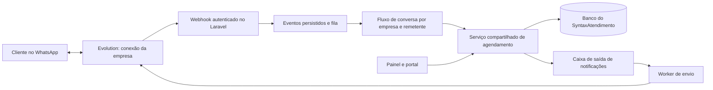

# Proposta de integração WhatsApp com Evolution API

Data: 02/11/2026. Proposta de arquitetura. Conexão por QR Code, avisos ao prestador e histórico de envios já foram implementados; consulte [o guia de instalação e uso](EVOLUTION_SETUP.md). O agendamento por conversa permanece uma etapa futura.

## Decisão proposta

Usar a Evolution como transporte de mensagens e manter cadastro, disponibilidade, agendamento e autorização no Laravel. Uma conexão por empresa/número, vinculada ao `company_id`, atende o modelo atual. Se uma empresa tiver vários profissionais ou agendas independentes, modelar esses recursos antes de prometer escolha de profissional no bot: hoje a disponibilidade é calculada por empresa.

Começar com menus de texto numerados, confirmação explícita e encaminhamento ao prestador. Linguagem natural pode entrar depois, convertendo mensagens em intenções; datas, serviços, preços e horários continuam validados no backend.

A Evolution oferece conexão Baileys/WhatsApp Web e integração com a Cloud API oficial. Para oferta comercial de avisos automáticos, priorizar a modalidade oficial; um piloto com QR Code/Baileys é uma opção separada de implantação e não equivale à integração oficial. [Visão geral](https://docs.evolutionfoundation.com.br/evolution-api), [Cloud API](https://docs.evolutionfoundation.com.br/evolution-api/integrations/cloudapi).

## Base existente e lacunas

- `app/Services/WhatsappService.php`: usa autenticação, sessões e envio do WPPConnect. Não basta trocar a URL por uma Evolution.
- `WhatsappSetupController`: já possui rotas autenticadas para iniciar sessão, consultar status/QR e desconectar.
- `SendAppointmentAlertJob`: já registra notificações; o WhatsApp atual é enviado ao destinatário configurado do prestador. Falhas são capturadas, mas não há uma caixa de saída com repetição controlada por destinatário.
- `AppointmentReminderNotification` e `SendAppointmentReminders`: lembrete atual por e-mail, com marca única `reminded_at`.
- `AvailabilityService`: calcula serviços, duração, bloqueios e conflitos. Reutilizar suas regras no bot.
- Agendamento está nos controllers. Extrair um serviço de aplicação compartilhado entre painel, portal e WhatsApp.
- O Compose está em `QUEUE_CONNECTION=sync`; existem jobs, mas falta execução assíncrona dedicada nesse ambiente.
- Não foi localizado processamento de conversas recebidas para marcar horários.

## Experiência do prestador

Em Configurações → Integrações → WhatsApp:

1. Conectar o número da empresa. No modo Baileys, mostrar QR e seu estado; no modo oficial, usar o fluxo de credenciais/onboarding correspondente.
2. Habilitar confirmação, alterações, cancelamento e lembretes. Separar avisos para clientes de avisos ao prestador.
3. Habilitar agendamento automático; configurar saudação, antecedência mínima, horizonte da agenda, intervalos dos lembretes e política de cancelamento.
4. Ver conexão, falhas de entrega, última atividade e conversas encaminhadas ao atendimento humano.
5. Pausar o bot por conversa e retomar explicitamente, evitando respostas simultâneas com o profissional.

Credenciais e chave administrativa ficam exclusivamente no backend. A tela recebe apenas estado e informações necessárias à conexão.

## Conversa de agendamento

Exemplo proposto:

- Cliente: “Quero marcar um corte”.
- Bot: apresenta serviços ativos com duração e preço; cliente escolhe.
- Bot: solicita dia e apresenta uma lista curta de horários reais, com opções de próximo dia e mais horários.
- Bot: identifica o cliente ou pede nome quando necessário.
- Bot: resume empresa, serviço, data completa, horário e preço; cliente confirma.
- Laravel: revalida e grava; só então o bot confirma o agendamento.

“AMANHÔ, datas e horários usam o fuso configurado para a empresa. Silêncio expira a conversa. “VOLTAR”, “RECOMEÇAR” e “ATENDENTE” têm comportamento definido. Mensagem ambígua pede esclarecimento. Áudios e mídias encaminham ao prestador no MVP.

Identidade: usar identificadores e metadados confiáveis do remetente fornecidos pelo canal, normalizando telefone quando disponível. Não inferir identidade por nome de exibição. Não presumir que todo JID é um telefone; tratar o identificador do canal e seu mapeamento. Se houver mais de um cadastro com o mesmo telefone, exigir seleção/verificação ou atendimento humano antes de consultar ou alterar históricos. Não vincular automaticamente uma conta global apenas porque o telefone coincide.

## Arquitetura e processamento

Webhook proposto: `POST /api/webhooks/whatsapp/evolution/{connection_id}`. Autenticar com segredo próprio da conexão em header, comparar com segurança e conferir a associação da instância. O identificador da URL não autentica a requisição. A referência de webhook permite headers personalizados; validar o contrato na versão instalada. Não usar a chave global de administração como segredo público de webhook. [Set Webhook](https://docs.evolutionfoundation.com.br/evolution-api/set-webhook).

Receber eventos de mensagens, conexão, QR e atualizações de envio. Persistir antes de responder HTTP 2xx e processar em fila. Duplicar a entrega do webhook não pode criar dois agendamentos. Ignorar grupos, status/broadcast, mensagens próprias e sincronizações históricas para evitar disparos indevidos. Serializar a conversa por conexão e remetente e tratar mensagens fora de ordem. Os eventos documentados incluem `MESSAGES_UPSERT`, `MESSAGES_UPDATE`, `CONNECTION_UPDATE` e `QRCODE_UPDATED`. [Eventos](https://docs.evolutionfoundation.com.br/evolution-api/configuration/webhooks).

## Dados e componentes propostos

| Componente | Responsabilidade |
| --- | --- |
| `WhatsappProviderInterface` | Conectar, consultar estado, desconectar, enviar e normalizar eventos. |
| `EvolutionWhatsappProvider` | Adaptar os contratos da versão fixada da Evolution. Manter WPPConnect separado durante a transição. |
| `AppointmentBookingService` | Criar/remarcar/cancelar, validar autorização e disponibilidade, gravar em transação e gerar eventos após commit. |
| `whatsapp_connections` | Empresa, provedor, instância imutável, estado, credenciais criptografadas, segredo do webhook e configuração. |
| `whatsapp_contacts` | Empresa/conexão, identificador do remetente, telefone quando conhecido, cliente associado e preferência de mensagens. |
| `whatsapp_conversations` | Estado atual, seleção de serviço/data/horário, expiração e pausa para humano. |
| `whatsapp_events` | Identificador do evento/mensagem, tipo, empresa, estado do processamento e retenção limitada do payload. |
| `notification_outbox` | Canal, destinatário, agendamento, revisão, tipo de aviso, vencimento, tentativas, identificador remoto e estado de entrega. |

Usar índices únicos para eventos recebidos e avisos por agendamento/revisão/tipo/destinatário. Eventos de atualização de uma mensagem não devem ser confundidos com duplicatas da mensagem recebida.

Reaproveitar `NotificationLog` como auditoria, distinguindo aceito pelo provedor, entregue, lido e falhou. Timeout de envio não comprova que a mensagem deixou de sair: reconciliar pelo identificador remoto quando possível e evitar repetição automática cega.

## Agenda única e concorrência

O bot agenda com as regras de cliente, sem herdar a exceção do prestador que permite qualquer horário. Não disponibilizar um token de prestador ao bot.

Consultar disponibilidade não reserva o horário. Na confirmação, usar transação e um bloqueio compartilhado entre todos os canais, por empresa/agenda e dia; uma implementação inicial pode bloquear a linha da empresa e revalidar o intervalo inteiro do serviço antes de gravar. A unicidade de hora inicial sozinha não impede sobreposição de atendimentos com durações distintas.

Preservar qualquer sobreposição manual autorizada ao prestador como regra explícita, fora do fluxo automático. Publicar a notificação após commit. Um horário ocupado durante a conversa resulta em novas opções, nunca em confirmação fictícia.

## Avisos e operação

Primeira entrega: confirmação e atualização/cancelamento para o cliente; alertas ao prestador quando habilitados. Depois, lembretes configuráveis, por exemplo no dia anterior e uma hora antes, sem enviar um aviso atrasado ou de agendamento já cancelado/concluído.

Na remarcação, invalidar os lembretes da revisão anterior e recalcular. Registrar cada canal e intervalo separadamente; `reminded_at` único não cobre vários lembretes nem falhas parciais.

Subir Evolution, banco próprio e Redis com volumes persistentes; worker e scheduler do Laravel como processos dedicados. Separar ambientes, credenciais e números de teste. Se Evolution e Laravel estiverem na mesma rede Docker, o webhook pode usar endereço interno; uma instalação externa precisa alcançar uma URL HTTPS pública. Fixar uma versão e validar payloads de criação, envio e webhook em teste de contrato: páginas genéricas e referências de endpoints podem representar versões diferentes. [Docker](https://docs.evolutionfoundation.com.br/evolution-api/install/docker), [Criar instância](https://docs.evolutionfoundation.com.br/evolution-api/create-instance), [Enviar texto](https://docs.evolutionfoundation.com.br/evolution-api/send-text-message).

Na modalidade oficial, avisos iniciados fora da janela de atendimento de 24 horas exigem modelos aprovados. Registrar autorização para os avisos, permitir desativação e oferecer contato humano. Considerar tarifas vigentes da Meta e infraestrutura na oferta comercial; não assumir operação sem custo. [Política oficial](https://business.whatsapp.com/policy).

## Entregas e critérios de aceite

1. **Conexão e avisos:** conexão por empresa, adaptador Evolution, status, webhook autenticado, fila, caixa de saída, confirmação e lembretes. Testar reconexão e entrega repetida.
2. **Agendamento no chat:** serviços, data, horários, confirmação, cadastro mínimo e atendimento humano. Testar duas pessoas disputando o mesmo intervalo e conflito entre portal e WhatsApp.
3. **Gestão pelo chat:** consultar próximos atendimentos, confirmar presença, remarcar e cancelar somente o agendamento do remetente identificado.
4. **Linguagem natural opcional:** interpretar pedidos, mantendo confirmação explícita e execução no serviço de agenda.

Antes do piloto real, definir hospedagem/versão da Evolution, modalidade de conexão, número de teste e o responsável pelo atendimento humano. Validar instâncias e conversas de duas empresas para comprovar isolamento; testar remetentes ambíguos, eventos repetidos, mensagens próprias, pausa do bot, expiração, remarcação e indisponibilidade do provedor.
